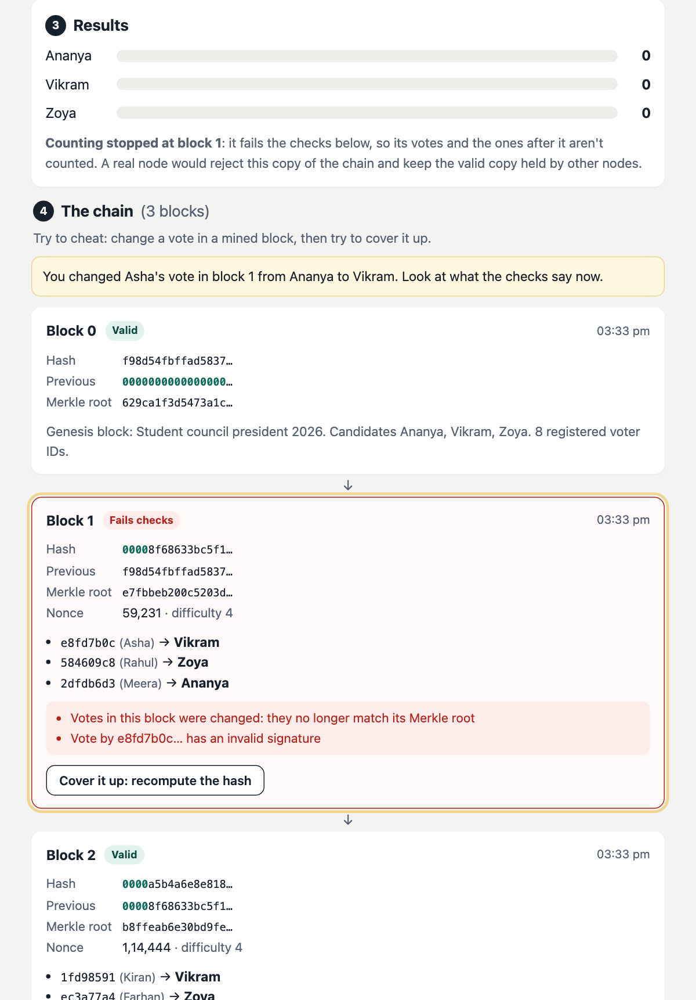

# Blockchain e-voting: live demo

**Try it:** https://finalcommitprojects.github.io/demo-blockchain-voting/

Cast signed votes, mine them into blocks, then try to change one and watch the chain catch it.

This repository only hosts the live demo, so the JavaScript here is bundled and minified. The full source code, with the setup or training scripts, tests, documentation and the project report, comes with the project when you take it with [Final Commit](https://finalcommitprojects.github.io/?utm_source=github&utm_campaign=demo-blockchain-voting).

© 2026 Final Commit. All rights reserved.
